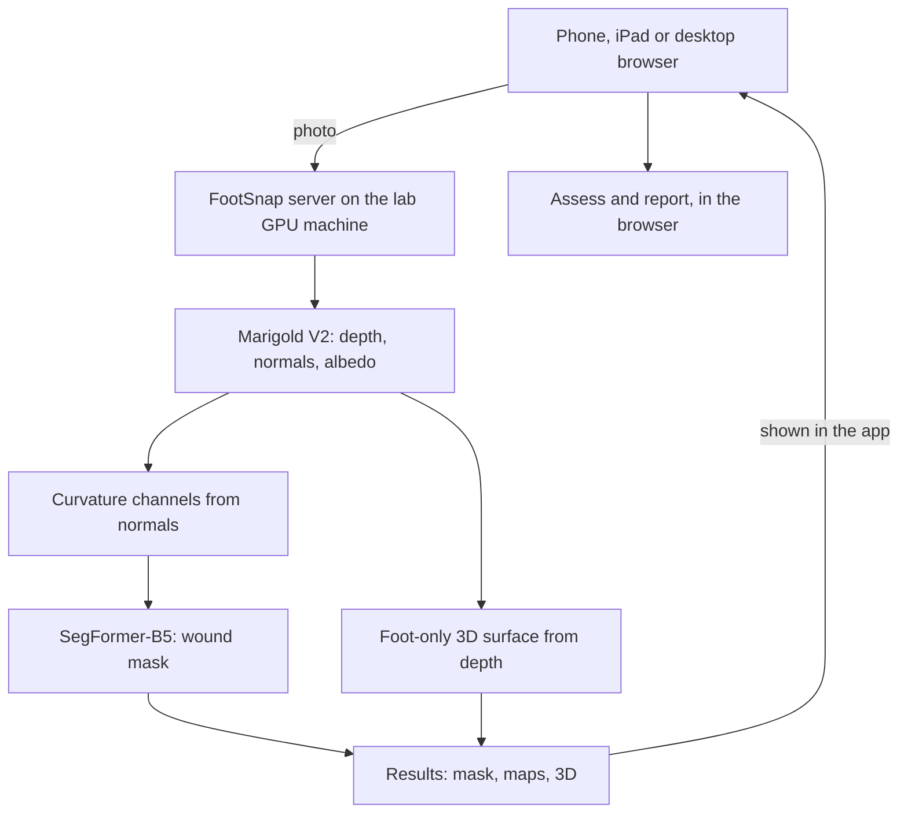

# FootSnap

**A clinician app for diabetic foot ulcer photographs.** Take a photo, see the wound segmented,
turn an estimated 3D surface of the wound, complete a structured assessment, and print a report.

FootSnap puts the depth-informed segmentation research (SegFormer-B5 with Marigold curvature
channels, trained on DFUC2022) into a tool a clinician can use on a phone, iPad or desktop.

> Research prototype. Not a medical device and not validated for clinical use.


## What it does

| Step | What the clinician sees |
|---|---|
| **1. Capture** | Take or upload a photo, or pick one from the sample library. Any analysed photo can be saved to the library from Review. Capture guidance on screen. |
| **2. Review** | The wound boundary over the photo. Overlay opacity, colour and zoom. The photo can be swapped for Marigold's albedo, depth or normals map, with the boundary still aligned. |
| **3. 3D** | The wound and the foot as a 3D surface, with the sheet and background removed: surface or wireframe, wound close-up or full foot, auto-rotate. Labelled *relative scale*. |
| **4. Assess** | The wound assessment form (AireForms fields, each asked once). Length and width are measured on the photo against a ruler; University of Texas and Wagner grades are suggested for the clinician to confirm; contradicting answers are flagged. |
| **Report** | A formal A4 clinical report with the annotated photo, measurements and how each was obtained, findings and a sign-off block. Print, save as PDF or copy into AireForms. |

Every result is labelled with where it came from: **Model results** (this photo, from the
server), **Imported outputs** (a mask the clinician loaded) or **Sample outputs** (pre-computed,
sample library only). A new photo is never shown sample results.


**Foot-only 3D.** The surface is built only where the foot is, found from the photo and the depth
map, so sheets, walls and the date stamp no longer appear, and stretched "spike" triangles at
depth edges are removed. Left: whole photo. Right: FootSnap.


## How it works



The server runs exactly the research pipeline: the feature code is copied unchanged from
`extract_features.py`, Marigold is called as in `marigold.py`, and the 3D surface follows
`reconstruct_3d.py`. The phone only displays results; analysis needs the GPU.

## What was checked

| Check | Result |
|---|---|
| Trained checkpoint loaded without torch (numpy SegFormer-B5), case 200001 | Dice **0.998** against the supplied mask |
| 3D surface rebuilt from the research outputs (`reconstruct.py` was not available) | Same vertex grid and colours as `points.ply`; **99.99 %** of `mesh.ply` faces |
| Foot-only 3D on case 200001 | Background removed: full surface 19,185 → 10,826 points at the same grid, no spikes |
| Full flow through the app (upload → review → 3D → assess → report) | Tested in a browser at iPhone 16 Pro, iPad and desktop sizes against the running server |
| Measurement on the photo (scale, length, width) | Exact to the tapped pixel (e.g. 30 px/cm → 3.5 × 2.5 cm) |
| Unit tests | `tests/`: reconstruction, mesh files, sizes, classification, checks (10 tests) |

**Not yet run:** Marigold and the model on the GPU together, the curvature channels with the
training `features/stats.json`, and the app in Safari on a real iPhone. Details in
[docs/technical-notes.md](docs/technical-notes.md).

## Quick start

On the machine with the research project and GPU:

```bash
git clone <this repository> footsnap && cd footsnap/server
pip install -r requirements.txt                   # torch + transformers come from the research env
cp /path/to/runs/segformer_curvature_seed0/model.pt .
export PROJECT=/path/to/0003-Depth_Segmentation  # finds features/stats.json, marigold-v2, saved maps
python server.py
```

Open `http://<machine address>:8000` on a phone on the same network, then *Add to Home Screen*.
Full setup, iPhone notes and the sample library: [docs/setup.md](docs/setup.md).

**Windows (Anaconda Prompt):** `setup_windows.bat`, then `start_server.bat`. See [docs/windows.md](docs/windows.md).

**iPhone app:** a native iOS app for the same server is in [`ios/`](ios/README.md). Build it from a Mac with Xcode.

## Repository layout

```
server/
  server.py              HTTP API; serves the app
  settings.py            all paths and options (or environment variables)
  build_samples.py       fills the app's sample library using the same pipeline
  pipeline/
    analyse.py           one photo in, everything the app shows out
    features.py          date-stamp finder + curvature channels (from extract_features.py)
    marigold.py          runs Marigold V2, or reuses saved maps
    segment.py           loads model.pt (torch on GPU, or numpy fallback)
    reconstruct.py       foot-only 3D surface, wound close-up, .glb / .ply / viewer files
    numpy_segformer.py   SegFormer-B5 in numpy (verification and CPU fallback)
    checkpoint_reader.py reads model.pt without torch
app/
  app.html               the app: capture, review, 3D viewer, assess, report
  assess.js              the assessment: questions, sizes, classification, checks, report
  demo/                  sample library (DFUC2022 case 200001)
ios/                     native iPhone app (SwiftUI) for the same server
tests/                   python + node tests, no GPU or data needed
docs/                    setup and technical notes
```

## Tests

```bash
python tests/test_reconstruct.py     # or: python -m pytest tests
node tests/test_assess.mjs
```

## Limitations

- **Sizes need a ruler in the photo.** Without one, FootSnap reports pixels, not centimetres.
- **The 3D surface is relative and one-sided.** It is estimated from one photo, so it shows the visible side of the foot, not millimetres; depth must be measured with a probe.
- **Classifications are suggestions** from the clinician's answers and must be confirmed.
- **Healing over time is not tracked yet;** each assessment stands alone.
- The model was trained on DFUC2022 photos; performance on other cameras and skin tones is untested.

## Next steps

1. Run the full pipeline on the GPU machine and on a real iPhone.
2. Detect a ruler or calibration sticker automatically.
3. A true full-foot model from several photos or a short video (multi-view reconstruction).
4. Link assessments of the same wound over time (area trend, % reduction at 4 weeks).
5. Send confirmed assessments to AireForms directly instead of copy and paste.

## Data, model and credits

- **Model weights** (`model.pt`, 323 MB) are not in this repository. Copy them from the training
  run into `server/` (see setup).
- **Sample image** `app/demo/200001/` is from the **DFUC2022** test set and is included for
  demonstration within the research group under its data agreement. Remove it before sharing
  the repository more widely.
- Built on [Marigold](https://github.com/prs-eth/Marigold) (depth, normals, albedo) and
  [SegFormer](https://huggingface.co/nvidia/mit-b5) (NVIDIA MiT-B5 via Hugging Face Transformers).
